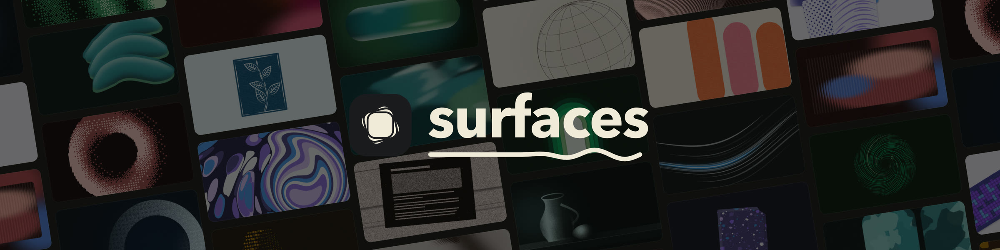

# Surfaces



Art drawn by code, not by an image model, for every picture a site
repeats: post covers and link previews, docs, changelog and email headers, empty states, episode art,
slides, tickets, wallpapers, and the headers of its X and LinkedIn profiles.
Make a brand once, from a colour or from the site's own pages, and every
picture after it follows from what it is about. The same title always draws
the same art.

The pictures are art. The words on them are yours, set in your own font.
There is no API key, no cost per image and no model that drifts: the same
input gives the same bytes on every build, in Node, an edge runtime or the
browser. It is meant to replace a site's covers as they are now, hand-made,
stock or placeholder; only a picture of one particular thing, a product, a
person or a place, stays a photo's job, or an image model's.

```sh
npm install @pogrobert/surfaces
```

It has no dependencies and runs on Node 20 or later, in the browser and on
an edge runtime. PNG and JPEG export go through resvg, which you install
when you want them: `npm install @resvg/resvg-js`. Try every style on your
own brand at [surfaces.pogrobert.com](https://surfaces.pogrobert.com); the
whole design is in [docs/api.md](docs/api.md).

## Set up a site

```sh
npx @pogrobert/surfaces init
```

It reads the site's own files (its `DESIGN.md` first, then its stylesheets,
Tailwind config, root layout, fonts, logo and metadata), chooses a look with
a reason for each choice, and writes:

- `surfaces.ts` beside the source, the brand everything comes from;
- a short block in `AGENTS.md`, so coding agents use it rightly;
- on Next.js, `app/opengraph-image.tsx`, the site's link preview;
- `.surfaces/directions.jpg`, a board of other looks; `init --pick 3` takes one.

Nothing is sent anywhere, and nothing it didn't write is changed.

`npx @pogrobert/surfaces kit` then writes the site's link preview and its X,
LinkedIn and email headers into `public/`, all on one mark, with the site's
own logo set on them. `preview --title "A real title"` draws the brand into
`.surfaces/` to look at, and `check` says whether every picture holds, so an
agent can look, fix and look again.

## A brand

```ts
import { createBrand, readPage } from "@pogrobert/surfaces"

const brand = createBrand({ name: "acme.dev", color: "#635bff", logo: logoSvg })
// or let the site decide: createBrand({ name: "acme.dev", ...readPage(html, css, designMd) })

brand.cover({ title: post.title })          // a post's cover
brand.cover({ title, tag: post.category })  // a category's posts make one mark
brand.cover({ title, id: post.slug })       // the art stays when the title is edited
brand.og({ title: post.title })             // a link preview, 1200 × 630
brand.hero({ title: "Pricing" })            // the one picture on a page that moves
brand.card({ title: post.title })           // a card in a list
brand.banner({ for: "x" })                  // and "linkedin", "email"
```

`brand.look` is every choice it made, as plain data: keep it, and the brand
is rebuilt exactly. `brand.why` says why each was made. To show a person
other looks, each already checked, and keep the one they like:

```ts
const options = directions({ name: "acme.dev", ...readPage(html, css) })
const brand = createBrand({ name: "acme.dev", ...options[2].look })
```

## Your words, in your font

A picture keeps a calm place for words where its use carries them over the
art: a link preview at the brand's own edge, a hero in the middle. A post's
cover, a card and a header keep none, since their words sit beside them, so
the art has the whole frame. `text` moves the place, or takes it away:

```ts
brand.cover({ title, text: "bottom-left" })  // room for the title at the foot
brand.og({ title, text: "none" })            // the whole frame for the art
```

The scene's first area is that place, in pixels, with the colour that reads
there: `scene.areas[0]` is `{ place, x, y, width, height, ink }`. In React,
`<Cover>` does all of it: it shows the title on the art itself, at a title's
size, in the page's own font, so the page needs no copy of the title beside
it:

```tsx
import { Cover } from "@pogrobert/surfaces/react"

<Cover brand={brand} title={post.title} />                 // the title, set on the art
<Cover brand={brand} title={post.title} heading="h1" />    // as the page's heading
<Cover brand={brand} title={post.title}><h1>{post.title}</h1></Cover>  // a heading styled your way
<Cover brand={brand} title={post.title} text="none" />     // the art alone, beside a heading the page has
<Cover brand={brand} title={post.title} use="card" />      // a card in a list: art alone
```

Not React? `coverHtml` is the same markup as a string, for Vue's `v-html`,
Svelte's `{@html}`, Astro's `set:html` or any template:

```vue
<div v-html="coverHtml({ brand, title: post.title })" />
```

Words over art are measured, not assumed. Where the art under them is calm
enough, nothing is laid over it. Where it isn't, a title drawn into the
image gets a halo of ground round its own letters, only as strong as that
art calls for, so the art shows right up to the words; and words the page
sets in the middle of a cover, which may stand anywhere in their area, get a
soft ground under the area, as weak as it can be.

## Link previews

A link preview is an image, so its title has to be in it. `drawTitle` sets
it into the image itself, drawn from the font's own outlines, so nothing
needs installing anywhere. Give it the site's font file, a TTF, a WOFF or a
WOFF2:

```ts
import { readFile } from "node:fs/promises"
import { loadFont } from "@pogrobert/surfaces"
import { toJpeg } from "@pogrobert/surfaces/png"   // needs @resvg/resvg-js installed

const font = await loadFont(await readFile("public/fonts/Brand.woff2"))
const jpeg = await toJpeg(brand.og({ title: post.title, drawTitle: { font } }))
```

In Next.js, as a route's `opengraph-image.ts`, on the Node runtime:

```ts
import { readFile } from "node:fs/promises"
import { join } from "node:path"
import { loadFont } from "@pogrobert/surfaces"
import { toJpeg } from "@pogrobert/surfaces/png"
import { brand } from "@/surfaces"                 // your brand module, as `init` writes it

export const size = { width: 1200, height: 630 }
export const contentType = "image/jpeg"
const font = readFile(join(process.cwd(), "public/fonts/Brand.woff2")).then(loadFont)

export default async function Image({ params }: { params: Promise<{ slug: string }> }) {
  const post = await getPost((await params).slug)
  return new Response(await toJpeg(brand.og({ title: post.title, drawTitle: { font: await font } })))
}
```

and in `next.config`, `serverExternalPackages: ["@resvg/resvg-js"]`, since
resvg is a native module. Without a server (Vite, a static site), write the
files in a build script, one after another, and point `og:image` at them
in HTML served as it is, since crawlers don't run JavaScript:

```ts
for (const post of posts) writeFileSync(`public/og/${post.slug}.jpg`, await toJpeg(brand.og({ title: post.title, drawTitle: { font } })))
```

To lay the title out yourself instead, as with Satori, draw the art alone
(`brand.og({ title })`) and set the words over `scene.areas[0]`, its box
and its `ink`; make it a JPEG, since a PNG of grainy art is too large for
chat apps to show.

`init` finds the file the site's headings use (next/font/local, an
`@font-face` or an `@fontsource` package), and writes its path into the
brand module as `titleFont` and into the link preview route. `drawTitle:
true` sets the title in a bundled sans or serif instead: Inter or Fraunces.
A variable font is drawn at its default weight, and a font with PostScript
(CFF) outlines isn't read yet.

A JPEG keeps a grainy picture to about 50–170 KB, under what chat apps show;
`toPng` gives it losslessly. On Node they use `@resvg/resvg-js` or
`@resvg/resvg-wasm`, whichever is installed; on an edge runtime or a Worker,
install the WASM one and pass its module: `toJpeg(scene, { wasm })`. The
bytes go straight into a response: `new Response(jpeg, { headers: {
"content-type": "image/jpeg" } })`.

A file has one theme. A brand that follows its reader (`theme: "auto"`, as a
site with a dark mode gets) draws its link previews and headers light, so
they export as they are; any other cover in both themes is drawn in one
first: `generate({ ...brand.input("post", { title }), theme: "light" })`.

## Everywhere else

Any other picture is the brand's input at the size the place needs, so a
docs header, an empty state and an episode's art are one family:

```ts
import { generate } from "@pogrobert/surfaces"

const at = (id: string, width: number, height: number) => generate({ ...brand.input("card", { id }), width, height })

at("docs/webhooks", 1600, 400)   // a docs page's header
at("empty/inbox", 800, 800)      // an empty state
at("episode-42", 3000, 3000)     // podcast or episode art
at("slides/q3", 1920, 1080)      // a slide's background
at("wallpaper", 1170, 2532)      // a phone wallpaper
```

Draw any of them with `toHtml` (inline on a page, the only output that
moves), `toSvg` (files, ``, email) or `toJpeg` and `toPng`. Draw a still
cover where the page is built, in a server component, a prerendered
route's loader or a build script, and the page ships none of Surfaces; see
"No drawing code on the page" in docs/api.md. `<Cover fill>` and
`<Surface fill>` fill the box they are put in, cropped to fit, and `frames`
gives a box a drawing for each shape it takes as it widens, 16:10 on a
phone and 3:1 on a desk, switched by CSS alone.

A brand's hero moves by itself, and any cover does when asked:
`generate({ ...brand.input("post", { title }), motion: "once" })`. Nineteen
of the styles move; the others are drawn still and say so (`moves` in
`catalog`). Readers who ask for less motion get the still drawing. A loop
runs for as long as the page is open, so give it a pause control:
`data-paused` on the cover or anything round it, `paused` on `<Surface>` and
`<Cover>`, or `pause()` and `play()` from `mount`.

## Styles

Thirty, each with its own shapes, in a light or dark ground, calm or
bold, smooth, natural or heavy grain, and any colour.

- **Printed:** stencil, screenprint, riso, linocut (landscapes, sprigs, waves, an initial), photocopy, halftone, dither, typewriter (the brand's initial, a page or a table, typed)
- **Engraved:** engraving, linework, currents (streams parting, whirling and joining), dashes (an orb, a cloud or hills in level dashes), moire, mezzotint, aquatint
- **Light:** underpaint (an aura of soft colour), sfumato, trails (lights in a long exposure), prism (bands of light with colour fringes), fluted (reeded glass), chrome, glass
- **Made:** papercut (layers of cut paper), weave (swatches, folds and straps of cloth), terrazzo (tiles, slabs, floors), swatchbook (cards of the brand's materials)
- **Pattern:** marbling, strata, endpaper, patches (soft forms in screen-tone patterns)

`catalog` lists every style with what it looks like, what it suits, its
shapes and whether it moves. A brand picks one from the site's own type,
words and colour; give `style` to choose. A page that draws in the browser
with one style can import that style alone, `@pogrobert/surfaces/underpaint`
and `@pogrobert/surfaces/underpaint/react`: the same functions and the same
pictures, with only that style's code.

A cover is drawn from the brand's colour: its ground and its shades are
chosen from it, and so is the second colour beside it, unless the brand
has its own: `createBrand({ name, color, partner: "#3730a3" })`, or one of the
second colours that sit well beside its own, from `partners(color, { style, mood })`:
a calm brand gets a neighbouring hue, a bold one a contrast, and Riso and
Screenprint a real riso ink that overprints cleanly (docs/colour.md says
why). Its hue and
strength are used and each style keeps its own lightness, so it can't make
a cover unreadable. Only the styles with `partner: true` in `catalog` set a
second hue; the rest are one hue and ignore it. `readPage` takes the site's
own secondary or accent colour when it has one; otherwise the brand picks a
partner by its name, among the colours a printer would pair with its own,
and keeps it in `brand.look`. There is no
background to give, and no transparent ground. `mood` keeps a
style to its quiet end (`"calm"`) or its loud one (`"bold"`); `grain:
"smooth"` is a little grain, never none.

## Alt text

A picture under its page's heading is decoration and stays hidden from
screen readers; a list of covers reads as its titles. Label one only where it
stands alone: `label={post.title}` when the cover is itself the link, and
`describe(scene, { title })` for a link preview or a gallery, as
`<meta property="og:image:alt">`. A cover with its title drawn into it is a
picture of words, so it reads the title out without being told.

## Link previews from a URL

```ts
import { generate } from "@pogrobert/surfaces"
import { createHandler, signUrl } from "@pogrobert/surfaces/http"
import { toJpeg } from "@pogrobert/surfaces/png"

const secret = process.env.OG_SECRET
export const GET = createHandler({ brand, jpeg: (input) => toJpeg(generate(input)), secret })
// <meta property="og:image" content={await signUrl(`https://acme.dev/og?title=${encodeURIComponent(title)}`, secret)}>
```

With a brand, a URL says only what the picture is about: `title`, `id`,
`tag`, `use` and `format`, which is a JPEG when the handler is given `jpeg`
(an `og:image` can't be an SVG), and the title is drawn in, in `font` when the handler is given
one from `loadFont`. With a `secret`, only signed URLs
are drawn, so no one else can have it draw what they like.

## One exact picture

A brand is how a site keeps one look. For a single picture outside one,
every choice is made by hand:

```ts
import { generate, toSvg, describe } from "@pogrobert/surfaces"

const scene = generate({
  style: "riso",                 // see `catalog`
  seed: "my-post",               // the page's slug or id; never 42 or "test"
  color: "#635bff",              // the brand colour, as hex
  partner: "#f59e0b",            // optional: the brand's second colour, as hex
  width: 1600, height: 900,      // optional; default 1600 by 900
  areas: [{ place: "bottom-left", size: "lg" }],  // where content goes
  theme: "light",                // "light", "dark" or "auto" (follows the reader)
  mood: "calm",                  // or "bold"
  grain: "natural",              // "smooth", "natural" or "heavy"
  motion: "none",                // "once" or "loop" (one hero per page at most)
})
const svg = toSvg(scene)
const alt = describe(scene, { title: "Changelog" })
```

Every value is a word from a fixed list. `place` is one of nine places
(`top-left` … `bottom-right`, `center`), `size` is `sm`, `md` or `lg`.
`art: "around"` (the default) keeps the art clear of the area so what sits
there reads; `art: "behind"` lays the content over the art, like an opaque
card. In React, `<Surface>` takes the same input, with each area's content:

```tsx
import { Surface } from "@pogrobert/surfaces/react"

<Surface style="riso" seed="pricing" color="#2b59c3" width={2400} height={1200}
  areas={[{ place: "center", size: "lg", content: <h1>Pricing</h1> }]} />
```

Plain DOM has `mount(element, input)` from `@pogrobert/surfaces/dom`, and
`createHandler` serves any input from a URL:
`/cover?style=riso&seed=launch&width=1200&height=630&area=bottom-left:lg`.

`generate` throws when the input is wrong, and the message names the fix
(`Unknown option "grian". Did you mean "grain"?`). `validate(input)` checks
without drawing.

## For agents

The package ships [AGENTS.md](AGENTS.md), a JSON Schema of the input
(`@pogrobert/surfaces/schema.json`, also `inputSchema`), [llms.txt](llms.txt)
and `catalog`.

## License

[MIT No Attribution](LICENSE): use it for anything, commercial or not, with
no credit needed. The bundled fonts, Inter and Fraunces, are under the SIL
Open Font License.
